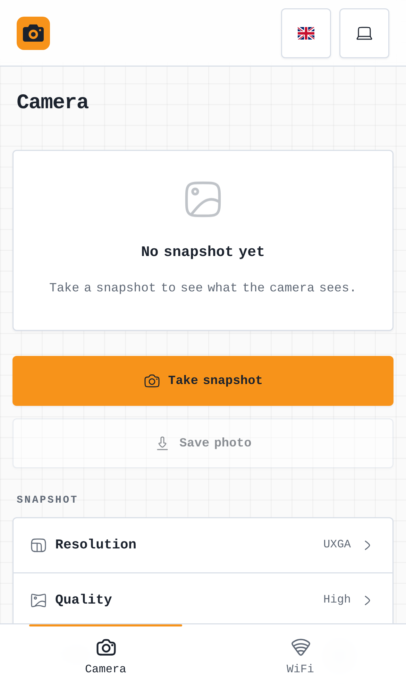
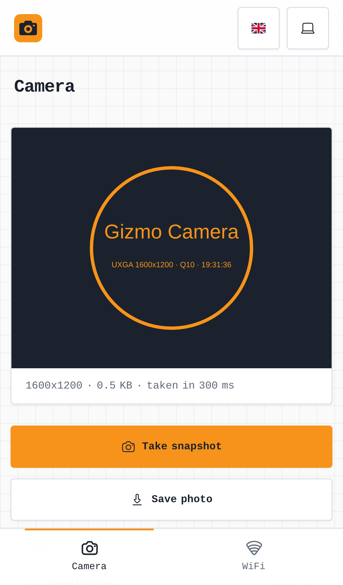
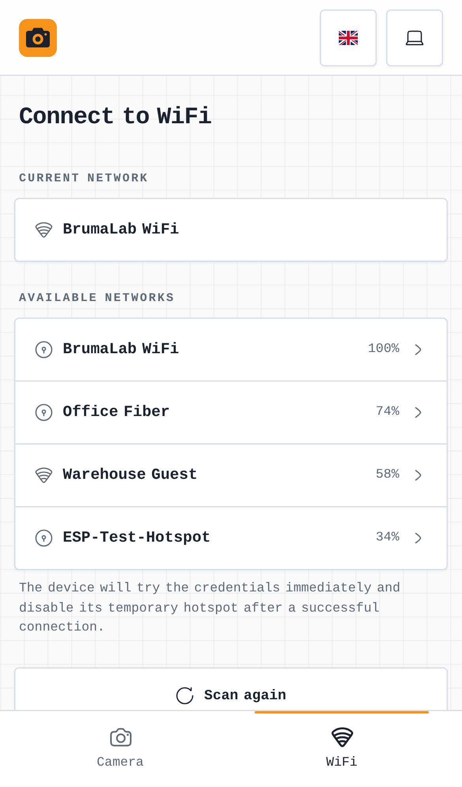

<div align="center">

# 📷 Gizmo Camera

### A Wi-Fi snapshot camera for the ESP32-CAM

Gizmo Camera is a two-part project that turns an AI Thinker ESP32-CAM into a small Wi-Fi camera: ESP32 firmware that takes JPEG snapshots on request, and a Nuxt 4 web app, built into the firmware, to set it up and take photos from your phone.

<p>
  <a href="https://github.com/open-gizmo/gizmo-camera"></a>
  
  
  
  
</p>

<p>
  📡 Wi-Fi setup from the phone • 📸 JPEG snapshots up to 1600 × 1200 • 🔦 Flash LED • 🌐 Simple HTTP API • 🌍 EN/IT UI
</p>

<p>
	<a href="#overview"><strong>Overview</strong></a> •
	<a href="#images"><strong>Images</strong></a> •
	<a href="#features"><strong>Features</strong></a> •
	<a href="#architecture"><strong>Architecture</strong></a> •
	<a href="#quick-start"><strong>Quick Start</strong></a> •
	<a href="#hardware"><strong>Hardware</strong></a> •
	<a href="#firmware-overview"><strong>Firmware Overview</strong></a> •
	<a href="#configuration"><strong>Configuration</strong></a> •
	<a href="#troubleshooting"><strong>Troubleshooting</strong></a> •
	<a href="#license"><strong>License</strong></a>
</p>

</div>

<a id="overview"></a>
## 📘 Overview

Gizmo Camera gives a cheap ESP32-CAM module a proper job: a camera on your network that answers every request with a fresh photo. Point it at a 3D printer, a plant, a door or a parking spot, and anything that can make an HTTP request (a browser, a script, a home automation server, an AI agent) can see what it sees.

You flash it from the browser, join its setup hotspot from your phone, pick your Wi-Fi network, and it's ready. No IDE, no credentials in the code. The web app built into the firmware lets you take snapshots, choose their resolution and quality, turn on the flash, and save the photos.

Under the hood, every snapshot is a plain `GET /api/capture` request that returns a JPEG, so the same camera works just as well from a script as from the web app.

<a id="images"></a>
## 🖼️ Images

### Screenshots

<div align="center">
	<table>
		<tr>
			<td align="center" valign="top">
				
			</td>
			<td align="center" valign="top">
				
			</td>
			<td align="center" valign="top">
				
			</td>
		</tr>
	</table>
	<p>
		<sub>Camera, snapshot, and WiFi setup screens (the web app's development server, with a test card instead of a photo)</sub>
	</p>
</div>

<a id="features"></a>
## ✨ Features

- JPEG snapshots on request, from 160 × 120 up to the sensor's largest resolution (1600 × 1200 on the OV2640).
- Adjustable JPEG quality, and the on-board flash LED for dark scenes.
- ESP32 firmware with Wi-Fi setup, an embedded HTTP server, and the web app built in.
- A small HTTP API (`/api/camera`, `/api/capture`) that scripts and other devices can call directly.
- Nuxt 4 interface to take snapshots, choose their options, and save the photos.
- `@brumaombra/ui-vintage` UI system shared across layout, forms, dialogs, and overlays.
- English and Italian localization.
- Captive-portal setup flow in AP mode and `gizmo-camera.local` hostname access after joining Wi-Fi. The API only answers the dashboard's own page and direct requests (scripts, `curl`), under the camera's own name or address, and through the setup hotspot only the Wi-Fi setup.
- Flashable from the browser on [opengizmo.dev](https://opengizmo.dev/projects/gizmo-camera), with versioned releases.

<a id="architecture"></a>
## 🏗️ Architecture

Gizmo Camera is built around three cooperating parts:

- 🔌 **ESP32 firmware** handles the camera, Wi-Fi, and the embedded HTTP server.
- 📷 **OV2640 camera and flash LED**, both on the ESP32-CAM board, take the snapshots.
- 🌐 **Nuxt web app** provides the browser-based setup and camera interface with theme, language, and shared UI-system support.

### 🔄 Data Flow

1. The web app (or any HTTP client) asks the ESP32 for a snapshot with `GET /api/capture`, with its resolution, quality and flash.
2. The firmware applies the options to the sensor, turns on the flash if asked, and takes a fresh frame.
3. The JPEG is streamed straight from the camera's frame buffer to the client, with its resolution and capture time in the response headers.

<a id="quick-start"></a>
## 🚀 Quick Start

### 🚀 Easy, no-code option

Use this path if you just want to flash the prebuilt firmware from the website. You do not need VS Code, PlatformIO, or a local build step.

1. **Plug the ESP32-CAM into its ESP32-CAM-MB USB board, and connect it to an available USB port on your PC.**

	The MB board is the small USB adapter the ESP32-CAM sits on: the ESP32-CAM has no USB port of its own.

2. **Open the [Gizmo Camera](https://opengizmo.dev/projects/gizmo-camera) project page.**

3. **Scroll down until you reach the firmware flashing card.**

4. **Press the "Flash firmware" button in the card to start the upload.**

	If the flasher can't connect, hold the **IO0** button of the MB board, press and release **RST**, then release **IO0** and try again: this puts the ESP32 in flashing mode by hand.

5. **Wait until the flashing process completes, then press RST on the MB board.**

6. **Join the `Gizmo-Camera` Wi-Fi network with your phone, and pick your Wi-Fi in the page that opens.**

7. **Enjoy your Gizmo Camera at [gizmo-camera.local](http://gizmo-camera.local)!**

### 🛠️ More technical option

If you want to build and flash everything yourself, follow this path:

1. **Install Visual Studio Code and PlatformIO.**

	Open the repository in VS Code, then install the PlatformIO extension so you can build and upload the firmware from the editor. The firmware project lives in `microcontroller/`, and PlatformIO uses the settings defined in `microcontroller/platformio.ini`.

2. **Build the app UI first.**

	The web app lives in `webapp/` and needs Node.js 24.21 or newer. From that folder, install the exact dependencies of the lockfile and build the embedded UI bundle:

	```bash
	npm ci
	npm run build:embedded
	```

	This runs the Nuxt static build, then the `gizmo-embed` tool from [gizmo-common](https://github.com/open-gizmo/gizmo-common) turns it into gzipped C++ assets for the firmware. Re-run it any time you change the web UI, translated labels, or embedded pages.

3. **Build the microcontroller code.**

	Open `microcontroller/` in PlatformIO and run the firmware build. From the CLI, the equivalent command is:

	```bash
	pio run
	```

	This compiles the firmware for the ESP32-CAM together with the current web UI assets and the libraries declared in `platformio.ini`.

4. **Upload the firmware to the ESP32.**

	After a successful build, upload the firmware to the board from the PlatformIO toolbar or with:

	```bash
	pio run --target upload
	```

	Make sure the ESP32-CAM is on its MB board and connected over USB before uploading. If the board does not start correctly after flashing, open the serial monitor to check boot logs:

	```bash
	pio device monitor
	```

	The released firmware keeps the serial log off. To see it, flash the `debug` build profile (see [Build profiles](#build-profiles)):

	```bash
	pio run -e debug --target upload
	pio device monitor
	```

<a id="hardware"></a>
## 🔌 Hardware

### Board

The firmware targets the **AI Thinker ESP32-CAM** (PlatformIO board `esp32cam`): an ESP32 with 4 MB of PSRAM, an OV2640 camera, and a white flash LED, flashed through the **ESP32-CAM-MB** USB board it plugs into.

The PSRAM holds the camera's frame buffer, so the firmware needs a module that has it (every AI Thinker ESP32-CAM does).

### Pinout

Everything is wired on the board: there is nothing to connect besides the camera's ribbon cable and the MB board.

| Function | GPIO |
| --- | --- |
| Camera clock (XCLK) | `0` |
| Camera SCCB (SDA, SCL) | `26`, `27` |
| Camera data (D0 to D7) | `5`, `18`, `19`, `21`, `36`, `39`, `34`, `35` |
| Camera VSYNC, HREF, PCLK | `25`, `23`, `22` |
| Camera power down | `32` |
| Flash LED | `4` |

GPIO0 is both the camera clock and the BOOT strapping pin, so the firmware never reads it as a button: the ESP32-CAM has no BOOT-button factory reset like the other OpenGizmo devices. Forget the Wi-Fi from the web app instead, or move the camera out of range of its saved network, and it opens its setup hotspot again.

### Camera

- Sensor: `OV2640` (2 MP), on the ribbon connector of the board
- Largest resolution: `UXGA` (1600 × 1200)
- Flash: the white LED next to the camera, on GPIO4

<a id="firmware-overview"></a>
## 🔍 Firmware Overview

### ⚙️ General

The firmware is responsible for the runtime behavior of the physical camera.

- Starts the OV2640 with its frame buffer in PSRAM, and keeps running without it, so the web app can say what's wrong.
- Connects the ESP32 to Wi-Fi.
- Hosts the embedded HTTP server and the camera API.
- Takes snapshots on request and streams them straight from the frame buffer, without copying them.
- Serves the embedded web UI assets.
- Keeps AP setup available during onboarding and exposes `gizmo-camera.local` on supported networks after joining Wi-Fi.

### 🧩 Firmware Layers

The firmware is split into focused modules under `microcontroller/src/`:

- 📷 `camera/` starts the sensor and takes snapshots (`camera.*`), with the resolutions and the reading of the request options kept hardware-free in `capture_options.*`. The pins are in `camera_pins.h`.
- ⚙️ `config/` holds the project name and the shared web server.
- 🌐 `server/` exposes the embedded HTTP routes (`/api/camera`, `/api/capture`, and the web app).
- 🧾 `serial/` turns on the serial log in the debug build.
- 🔌 `wifi/` gives the camera's names to the shared Wi-Fi setup.

### 🧪 Tests

The hardware-free logic (the resolutions, and how the options of a snapshot request are read and checked) is tested on your computer, no board needed:

```bash
cd microcontroller
pio test -e native
```

The tests live in [microcontroller/test/](microcontroller/test/). They also run in the release workflow before the firmware is built.

The web app has its own tests (its pages, the mock device API and the translations), with Vitest:

```bash
cd webapp
npm test
```

They live in [webapp/tests/](webapp/tests/), and [webapp/tests/README.md](webapp/tests/README.md) explains how they are built.

Logging, the web API helpers, the device API and the whole Wi-Fi setup (connection, setup hotspot, captive portal, and the `/api/networks`, `/api/connect` and `/api/check-connection` endpoints) come from the shared [gizmo-common](https://github.com/open-gizmo/gizmo-common) library, which has its own tests.

### 🌐 Web App Overview

The Nuxt app provides the browser-based setup and camera interface.

- Lets users configure Wi-Fi and take snapshots.
- Offers the resolutions the sensor can take, a few quality presets, and the flash.
- Shows the last snapshot with its resolution, size and capture time, and saves it as a JPEG file.
- Supports English and Italian localization.
- Uses the `@brumaombra/ui-vintage` package for the shared design system.
- Includes library-managed busy and message flows for snapshots and errors.
- Keeps device API helpers and camera state in `webapp/app/composables/`.
- Uses static generation for the embedded web UI bundle that is packaged into firmware assets.
- During development (`npm run dev`), a mock device in `webapp/server/` answers like the firmware, with an SVG test card in place of the photo.

#### 🎨 UI System

The web app splits UI responsibilities between the shared packages and the app itself.

- `@brumaombra/ui-vintage` provides the reusable UI system.
- The gizmo-common web layer provides the dashboard layout, the Wi-Fi pages, the device card, and the mock device for the Wi-Fi and device routes.
- `webapp/app/pages/camera.vue` is the camera page, and `webapp/app/app.config.ts` sets the name, logo and navigation for the layer.
- `webapp/app/assets/css/main.css` imports the shared library and layer stylesheets.
- `webapp/app/composables/useCamera.js` and `webapp/app/composables/stores/useGlobalStore.js` keep the camera details, the snapshot options and the last snapshot local to the app.

<a id="configuration"></a>
## ⚙️ Configuration

### Build profiles

[platformio.ini](microcontroller/platformio.ini) has the same three profiles as every OpenGizmo firmware:

- `release`, the default: the firmware the release workflow builds and the website flashes, with the serial log off.
- `debug`: the same firmware with the serial log on, and the ESP32 core's own messages. Flash it with `pio run -e debug --target upload`, then open `pio device monitor`.
- `native`: the tests of the hardware-free logic, on your computer (`pio test -e native`).

Nothing needs a secrets file: the Wi-Fi is set from the phone and saved on the board.

### Camera API

The camera answers on `http://gizmo-camera.local` (or its IP address) on your network:

| Request | Response |
| --- | --- |
| `GET /api/capture` | JPEG at the sensor's largest resolution |
| `GET /api/capture?resolution=SVGA` | JPEG at another resolution: `QQVGA`, `QVGA`, `CIF`, `VGA`, `SVGA`, `XGA`, `HD`, `SXGA`, `UXGA` on the OV2640 |
| `GET /api/capture?quality=12` | JPEG quality from 4 to 63, where lower numbers mean better quality. The default is 10. |
| `GET /api/capture?flash=1` | Turns on the flash LED for the shot |
| `GET /api/camera` | JSON with the sensor, its resolutions, the quality range, and whether it has a flash |
| `GET /api/device` | JSON with the firmware version, uptime, memory, network and signal (from gizmo-common) |

You can combine the options, for example `/api/capture?resolution=XGA&quality=12&flash=1`. Each snapshot comes with the `X-Resolution` and `X-Capture-Time-Ms` headers, and is never cached.

```sh
curl -o photo.jpg "http://gizmo-camera.local/api/capture?resolution=SVGA"
```

The camera takes one snapshot at a time: a request that arrives while another is being taken or sent gets `503` with the `camera_busy` error. Errors are JSON, in the format of every OpenGizmo device: `{ "errorId": "invalid_quality", "errorMessage": "...", "data": null }`.

### Firmware Defaults

Each snapshot starts from these defaults, unless its request says otherwise:

- the sensor's largest resolution (`UXGA` on the OV2640)
- JPEG quality 10
- flash off

### Runtime Flow

The device is configured through its embedded web UI and local network flow.

1. The ESP32-CAM starts in access point mode on first boot, as the `Gizmo-Camera` network.
2. The web app lets you pick the Wi-Fi network and enter its password from your phone.
3. The firmware saves the network and reuses it after reboot.
4. The camera can then be reached on the local network using `gizmo-camera.local` on supported setups.

### Key Files

- `microcontroller/src/camera/camera.cpp` for the sensor setup and the snapshots.
- `microcontroller/src/camera/capture_options.h` for the resolutions and the quality range.
- `microcontroller/src/server/endpoints/` for the camera API.
- `webapp/app/composables/useDeviceApi.js` for browser-to-device communication.

### Releasing a new version

Versions follow [semantic versioning](https://semver.org) (`vMAJOR.MINOR.PATCH`), in the `VERSION` file: a bug fix bumps the patch (1.0.1), a new feature that keeps the saved settings bumps the minor (1.1.0), and a change that resets the settings or needs new wiring bumps the major (2.0.0).

1. On `feature`, set the new version in `VERSION` and in `webapp/package.json` (`npm version X.Y.Z --no-git-tag-version` in `webapp/` updates its lockfile too).
2. Bring `main` up to `feature`.
3. Run the **Build & Release 📦** workflow by hand (Actions > Build & Release > Run workflow, on `main`). It checks the version is new and matches the web app, runs the tests, builds the web app and the firmware (which reports its version in `/api/device`), and creates the GitHub Release `vX.Y.Z` with the four flash parts and notes from the commits.
4. The same parts go to Cloudflare R2, with a `manifest.json` that lists each part and its flash address. The flash button on [opengizmo.dev](https://opengizmo.dev/projects/gizmo-camera) reads that manifest, so it always installs the latest release, and keeps the saved settings. The CDN caches the manifest for 60 seconds only, so the website offers a new release within a minute, with no purge.

The workflow only runs on `main`, and needs these secrets, on the repository or on the open-gizmo organization: `R2_ACCOUNT_ID`, `R2_ACCESS_KEY_ID`, `R2_SECRET_ACCESS_KEY` (an R2 API token limited to the bucket) and `R2_BUCKET`. It checks them first, and stops before releasing anything when one is missing.

<a id="troubleshooting"></a>
## 🧰 Troubleshooting

- The flasher can't connect to the board: check that the ESP32-CAM sits fully in its MB board, try another USB cable (some only charge), and use the IO0 and RST buttons to enter flashing mode by hand (see [Quick Start](#quick-start)).
- The web app says "Camera not found": the sensor didn't start. Power the board off, check that the camera's ribbon cable is fully inserted and its latch closed, then power it on again.
- The board restarts when the flash fires or during Wi-Fi setup: the ESP32-CAM draws current peaks a weak USB port or a thin cable can't supply (a brownout). Use a powered USB port or a good 5 V supply.
- The web UI does not open after joining Wi-Fi: make sure your phone or computer is on the same network as the camera and try the `gizmo-camera.local` hostname if your router supports mDNS, or the IP address shown by your router.
- Snapshots are slow at full resolution: a 1600 × 1200 JPEG is a few hundred KB over Wi-Fi. Pick a smaller resolution or a lower quality when you don't need every detail.
- A request answers `camera_busy`: another snapshot was being taken or sent at the same moment. Try again once it's done.
- The AP setup flow never appears: power-cycle the device and check the firmware logs (the `debug` build profile) for Wi-Fi connection errors.

<a id="license"></a>
## 📄 License

This project is licensed under the MIT License. See [LICENSE](LICENSE) for details.

---

<p align="center">
	
	<br/>
	<strong>Real projects. Real hardware. Real fun.</strong>
	<br/>
	<sub>A small corner of the internet for ESP32 builds that are useful, remixable, and actually fun to use.</sub>
</p>